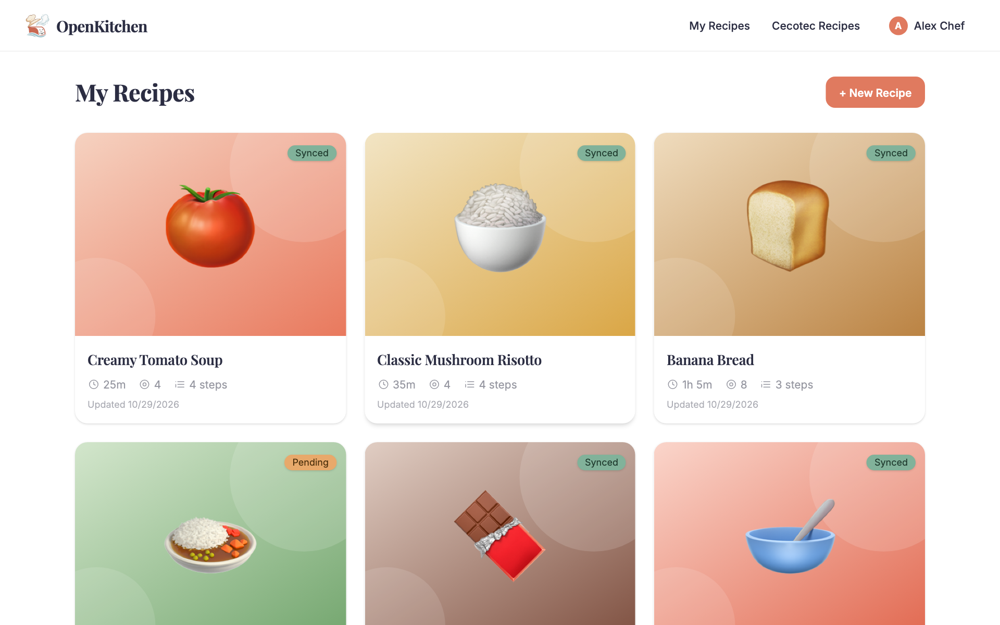
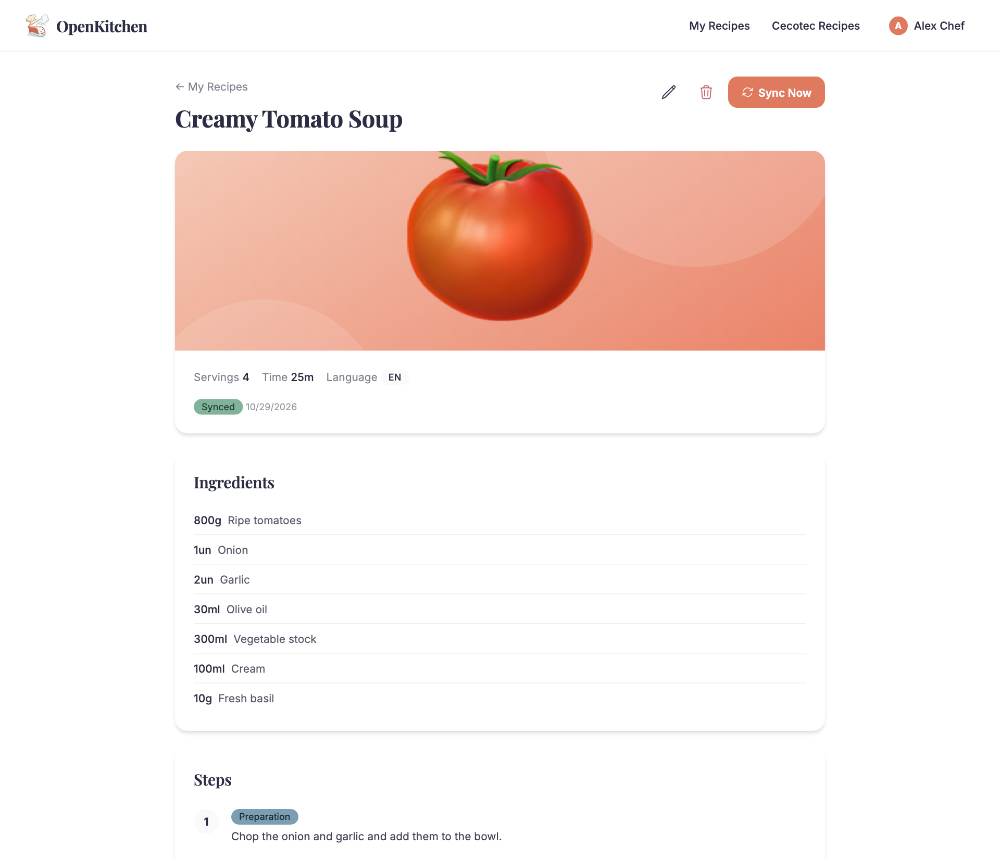
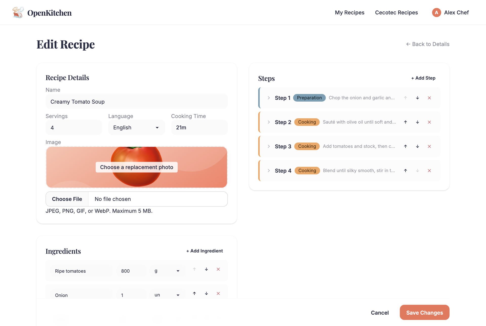
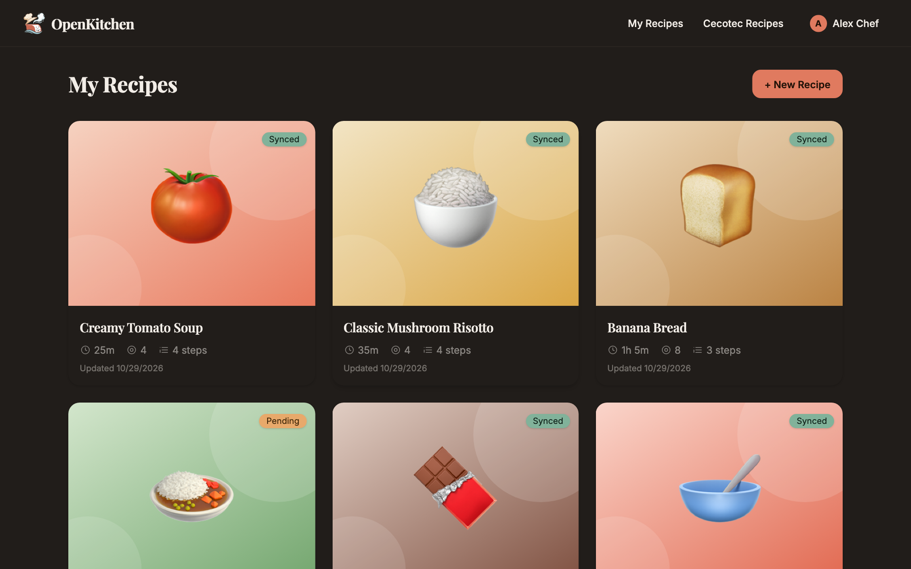
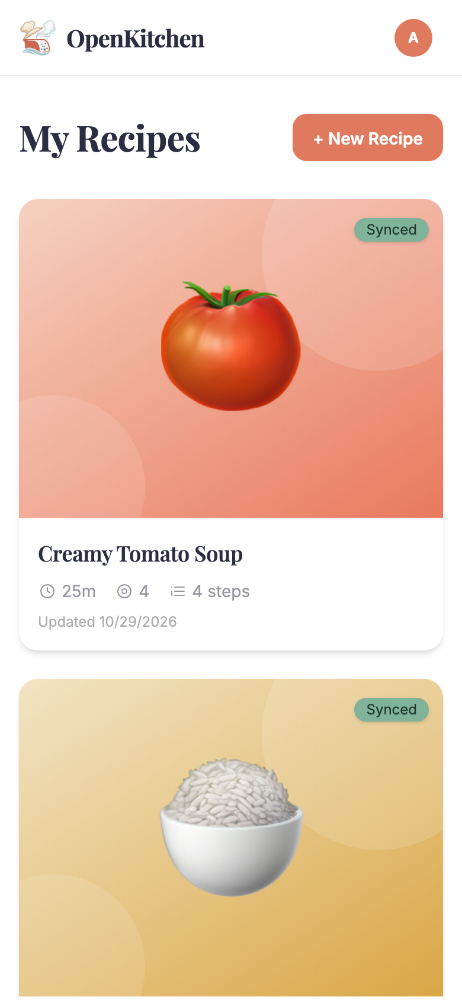

<p align="center">
  
</p>

<h1 align="center">OpenKitchen</h1>

<p align="center">
  <strong>The Cecotec Mambo recipe app you actually want to use.</strong><br />
  Write, browse and organize recipes in a fast, friendly web app, then send them to your kitchen robot with one click.
</p>

<p align="center">
  <a href="https://open-kitchen.vercel.app/"><strong>Try it live → open-kitchen.vercel.app</strong></a>
</p>

<p align="center">
  
</p>

> **Unofficial project.** OpenKitchen is not affiliated with, endorsed by, or sponsored by Cecotec. It talks to Cecotec's undocumented cloud API, which was reverse-engineered from their mobile app and may change or break at any time. "Cecotec" and "Mambo" are trademarks of their respective owners.

## What is it?

If you own a Cecotec Mambo, you've probably met the official app, and you've probably been frustrated by it. Creating your own recipe is a long, multi-step process on a small phone screen, and ingredient units have a habit of changing on their own. It's easy to end up redoing work you already did.

OpenKitchen is a free, open-source alternative. Write your recipes with ingredients, steps, times, temperatures and photos in one comfortable editor, search Cecotec's public catalog and copy any recipe into your own collection to tweak, then hit **Sync**. Your recipe shows up on your Mambo, ready to cook. And as a bonus, it's a nicer place to be: a clean interface, a dark mode, and a layout that works on your laptop as well as your phone.

## Why OpenKitchen?

- **One screen, not a maze.** Name, photo, ingredients and steps all live in a single editor. No multi-step wizard, and you see the whole recipe at once.
- **Units that stay put.** Ingredient amounts and units are saved exactly as you entered them, and you can reorder and edit anything at any time.
- **Better browsing.** Search Cecotec's public catalog by name and category, and import any recipe into your own library in one click.
- **Your recipes are yours.** They live in your own OpenKitchen library, and are synced to your Cecotec account when you choose.
- **Open source.** No ads, no lock-in. Read the code, fix what annoys you, or host it yourself.

## How it works

1. **Create an account** on OpenKitchen and link your Cecotec account on the Profile page.
2. **Write or import a recipe.** Start from scratch, or pick one from the Cecotec catalog and make it yours.
3. **Press Sync Now.** The recipe is published to your Cecotec account and appears on your Mambo.

<table>
  <tr>
    <td width="25%" valign="top"><a href="docs/screenshots/recipe-detail.png"></a></td>
    <td width="25%" valign="top"><a href="docs/screenshots/recipe-edit.png"></a></td>
    <td width="25%" valign="top"><a href="docs/screenshots/recipes-dark.png"></a></td>
    <td width="25%" valign="top"><a href="docs/screenshots/recipes-mobile.png"></a></td>
  </tr>
  <tr>
    <td align="center" valign="top"><sub><b>Recipe view</b><br />Ingredients, steps, time, temperature and speed</sub></td>
    <td align="center" valign="top"><sub><b>Editor</b><br />One screen, no multi-step wizard</sub></td>
    <td align="center" valign="top"><sub><b>Dark mode</b><br />Easy on the eyes</sub></td>
    <td align="center" valign="top"><sub><b>On your phone</b><br />Works great on mobile, too</sub></td>
  </tr>
</table>

<p align="center"><sub>Click any screenshot to enlarge it.</sub></p>

> The screenshots show demo recipes with illustrated covers. Your own recipes can use real photos.

## Features

- **Recipe editor**: ingredients, servings, cooking time, photos, and step-by-step instructions with manual, preparation and cooking steps (time, temperature, speed, power).
- **One-click Cecotec sync**: publish recipes to your own Cecotec account and keep them updated in place, so the cookbook ID stays stable. A badge on every recipe shows whether it's synced.
- **Public catalog browser**: search and filter Cecotec's public recipe catalog, then import any recipe into your own collection and edit it.
- **Image upload**: recipe photos go straight to Cecotec's CDN (JPEG, PNG, GIF or WebP, up to 5 MB).
- **Multilingual**: English, Spanish and Catalan.
- **Light and dark themes**, and a layout that works on phones.
- **Your credentials are encrypted at rest**: your Cecotec password is stored with AES-256-GCM and only used to log in to Cecotec on your behalf. Linking an account does mean trusting the server with that password, so please read [SECURITY.md](SECURITY.md) to see exactly how it is handled and how to wipe your data.

## Compatibility

| Device | Status |
|---|---|
| Cecotec Mambo Touch | Supported |
| Cecotec Mambo 11090 | Supported |
| Other Cecotec Mambo models | Unknown. OpenKitchen reads the model from the device linked to your Cecotec account, so some may already work, but we haven't tested them. |

**Own a different model?** We'd love to support it. Please [open an issue](https://github.com/sacha-c/open-kitchen/issues/new) with your model name and what happened when you synced a recipe (what worked, what didn't). Reports of recipes that sync fine are just as useful as bug reports.

## Tech stack

| | |
|---|---|
| Framework | [SvelteKit](https://svelte.dev/docs/kit) (Svelte 5), deployed on Vercel |
| Language | TypeScript |
| Database | Postgres ([Neon](https://neon.tech) in production), [Drizzle ORM](https://orm.drizzle.team) |
| Auth | [better-auth](https://www.better-auth.com) (email + password) |
| Styling | Tailwind CSS 4 + DaisyUI 5 |
| i18n | [Paraglide](https://inlang.com/m/gerre34r/library-inlang-paraglideJs) |
| Testing | Vitest (unit and browser), Playwright (E2E) |
| Tooling | pnpm, Biome |

## Getting started

### Prerequisites

- [Node.js](https://nodejs.org) 20 or newer
- [pnpm](https://pnpm.io) (the version is pinned in `package.json`)
- [Docker](https://www.docker.com), for the local Postgres

### Setup

```sh
git clone git@github.com:sacha-c/open-kitchen.git
cd open-kitchen
pnpm install

cp .env.example .env
```

Edit `.env` and fill in the values:

| Variable | Description |
|---|---|
| `DATABASE_URL` | Postgres connection string. The default points at the local Docker database. |
| `BETTER_AUTH_SECRET` | Secret used to sign sessions. Generate one with `openssl rand -base64 32`. |
| `BETTER_AUTH_URL` | Public base URL of the app, `http://localhost:5173` for local development. |
| `CECOTEC_ENCRYPTION_KEY` | 32-byte AES-256 key as 64 hex characters. Generate one with `openssl rand -hex 32`. |

Then start the database, create the schema and run the app:

```sh
pnpm services:start   # local Postgres via Docker
pnpm db:push          # apply the schema
pnpm db:seed          # optional: sample data and a test user
pnpm dev
```

Open <http://localhost:5173>. After signing up, go to **Profile** and link your Cecotec account to enable syncing and the catalog.

> Always develop against the local database, never against production.

### Useful commands

| Command | What it does |
|---|---|
| `pnpm dev` | Start the dev server |
| `pnpm build` / `pnpm preview` | Production build and local preview |
| `pnpm test:unit --run` | Unit tests (Vitest) |
| `pnpm test:e2e` | End-to-end tests (Playwright) |
| `pnpm lint` / `pnpm format` | Lint and format with Biome |
| `pnpm check` | Type-check Svelte and TypeScript |
| `pnpm db:generate` / `pnpm db:migrate` / `pnpm db:push` | Drizzle migrations |
| `pnpm db:studio` | Browse the database with Drizzle Studio |
| `pnpm services:start` / `pnpm services:stop` | Start or stop the local Docker services |

## Project layout

```
src/
  routes/               pages: recipes, Cecotec catalog, profile, auth
  lib/
    components/         shared Svelte components
    server/
      cecotec/          Cecotec API client, catalog import, constants
      sync/             recipe sync engine
      db/               Drizzle schema and connection
      auth.ts           better-auth setup
      crypto.ts         AES-256 encryption for stored Cecotec credentials
messages/               translations (en, es, ca)
drizzle/                database migrations
e2e/                    Playwright tests
scripts/seed.ts         local seed data
```

## How the Cecotec integration works

- You authenticate with your own Cecotec account. Your password is RSA-encrypted before it is sent to Cecotec, and stored encrypted at rest in OpenKitchen's database.
- A new recipe is created as a draft on Cecotec and then published. Later edits update it in place.
- Recipes imported from the public catalog start as local, pending recipes. They are created on *your* account on the next sync, so you own them.
- Catalog search relies on an undocumented `recipeName` parameter. It matches substrings only, with no typo tolerance.
- Cecotec's catalog only has English and Spanish content, so the Catalan locale falls back to Spanish for catalog requests.
- Ingredient lists can't currently be written through the API for user-created recipes. This is a known limitation of the Cecotec side.

## Recipe images

Recipe images are uploaded directly to the Cecotec CDN and the returned URL is stored with the recipe. OpenKitchen does not keep a second copy in Vercel Blob or another object store. This keeps the upload flow simple, but it means image uploads require you to link your Cecotec account first.

Uploads accept JPEG, PNG, GIF, and WebP files up to 5 MB. The 5 MB limit is an OpenKitchen policy; Cecotec does not publish a size or dimension limit for its `put-file` endpoint.

## Contributing

Issues and pull requests are welcome. To report a security problem, please follow [SECURITY.md](SECURITY.md) instead of opening a public issue. Before opening a PR, please make sure these pass:

```sh
pnpm lint
pnpm check
pnpm test:unit --run
```

The repo also ships agent guidance in [`AGENTS.md`](AGENTS.md) (conventions, design system, API notes) that is useful for human contributors too.

## License

[MIT](LICENSE) © 2026 Sacha Brouté, Sergio Castillo
